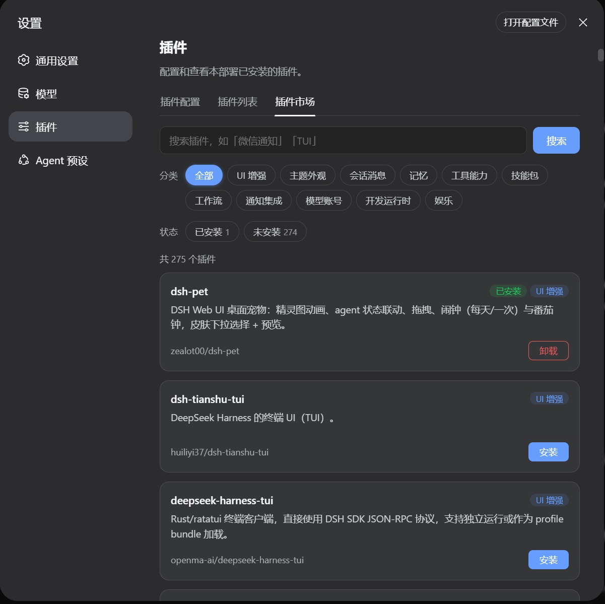

# dsh-plugin-registry

一个 DeepSeek Harness（DSH）插件：在会话内直接**检索**并**安装** [awesome-dsh-plugin](https://awesome-dsh-plugin.com) 精选列表中的插件。

- `search_dsh_plugins` — 按关键词/分类检索精选 registry，返回双语描述与安装命令。
- `install_dsh_plugin` — 真正把插件装进当前 profile（corepack pnpm add + 同步 `dsh.profile.bundles`，HMR 热加载，无需重启）。
- **可视化页面** — Web 设置页新增「插件市场」分区：搜索框 + 分类过滤 + 已安装/未安装状态过滤 + 一键安装/卸载（带确认弹窗），无需对话即可浏览/管理。

数据源：`https://raw.githubusercontent.com/beancookie/awesome-dsh-plugin/main/docs/plugins.json`（离线时回退到内置快照 `data/registry-snapshot.json`）。

## 安装

```sh
dsh plugin --profile web add github:beancookie/dsh-plugin-registry
```

安装完成后直接启动：

```sh
dsh web
```

## 使用

**推荐：页面安装** —— 启动 `dsh web` 后，打开设置 → 插件 → **插件市场**，可搜索、按分类/状态筛选、一键安装/卸载，无需对话：



**备选：对话安装** —— 直接对 agent 说：

- 「帮我找一个微信通知的插件」
- 「有什么终端 TUI 插件？」
- 「安装 dsh-pet」

agent 会依次调用 `search_dsh_plugins` 检索、`install_dsh_plugin` 安装。所有插件均为第三方代码，安装前 agent 会先向你确认。

## 卸载

```sh
dsh plugin --profile web remove dsh-plugin-registry
```

## 技术方案

### 整体架构

插件由「宿主侧」（Node，随 DSH 主进程运行）与「客户端侧」（浏览器 bundle，随 Web UI 运行）两部分组成，通过 `/api/dsh-plugin-registry/*` 自注册 HTTP 接口衔接。

```
dsh-plugin-registry
├── src/                      宿主侧源码（tsc → lib/）
│   ├── index.ts               入口：装配唯一的 ProfileStore，注册工具 + HTTP 路由
│   ├── registry.ts            远端 registry 拉取/缓存/检索/spec 归一化/ref 解析
│   ├── profile.ts             ProfileStore：profile 目录发现、manifest 读写、pnpm 执行、bundles 对账
│   ├── market.ts              searchHits：检索 + 附加安装状态（HTTP 与工具共用视图）
│   ├── tools.ts               DSH 工具：search_dsh_plugins / install_dsh_plugin
│   ├── api.ts                 HTTP 路由：/search /installed /install /uninstall
│   └── types.ts               共享类型
├── client/client.tsx          客户端源码（esbuild → lib/client.js）：「插件市场」设置页
├── scripts/build-client.mjs   esbuild 打包 + __ModuleLoader__ 包装
└── data/registry-snapshot.json  离线回退快照（275 插件 / 11 分类）
```

**核心设计原则**：安装状态只有单一事实源 —— 持久化的 profile 清单（`package.json` 的 `dependencies` + `dsh.profile.bundles`）。HTTP API 与 DSH 工具共享同一个 `ProfileStore`，刻意忽略 loader/HMR，保证「已安装」徽标与卸载行为完全一致。

### 关键模块

| 模块 | 职责 |
| --- | --- |
| `registry.ts` | `loadRegistry`（1h TTL 内存缓存 + 4s 超时 fetch + 快照回退）、`searchPlugins`、`installSpec`、`describe`、`resolvePlugin` |
| `profile.ts` | `ProfileStore`：`dir()` 目录发现、`manifest()` 读写、`pnpm()` 执行、`install()`/`uninstall()`、`reconcileBundles()` 对账、`normalizeSpec()` 等辅助函数 |
| `api.ts` | 单个 `prefix` 路由 `/api/dsh-plugin-registry`，按 pathname+method 分发 |
| `tools.ts` | 通过 `@deepseek-ai/dsh-tools` 的 `defineTool` 注册两个 agent 工具 |
| `client.tsx` | 在 `settings.plugins.tab` 槽位（id `market`）注册 React 页面 |

### 数据流

**检索（search）**

1. `loadRegistry()`：TTL 内直接返回内存缓存；否则 fetch 远端（4s 超时），校验 `plugins` 非空，失败则回退旧缓存或内置快照。
2. `searchPlugins()`：把查询串按空白拆成多关键词，每个关键词都必须在 `name`/`owner`/双语 `description` 中命中；可选按分类过滤；名称命中 +2 分、其余字段 +1 分，按总分降序取前 N 条。
3. `searchHits()`：为每条结果附加 `profile.installedEntries()` 算出的安装状态（以 URL 为唯一身份），产出统一的 `SearchHit` 视图 —— 工具（渲染为纯文本）与 HTTP（JSON）共用。

**安装（install）**

1. `resolvePlugin()`：把用户给的 ref 依次按 URL → `name` → `owner/repo` 解析为唯一 registry 条目，重名返回「歧义」错误，未命中返回「not found」。
2. `installSpec()`：从 registry 的 `install` 命令提取 pnpm spec，兼容 `github:owner/repo/tree/...` 无效形态（重建为 `github:owner/repo#path:/sub`）、npm 包名、以及裸 `github:owner/repo`。
3. `ProfileStore.install()`：串行队列执行 —— 读清单 → `matchInstalledDep()` 判重（已装则直接返回）→ `pnpm add <spec>` → `findAddedDependency()` 从依赖 diff 定位真实包名 → `reconcileBundles()` 对账插件层 → `isBundle()` 判断是否声明 `dsh.bundle` → 返回结果。
4. `reconcileBundles()` 镜像官方 `dsh plugin add/remove`：把声明 `dsh.bundle` 的新依赖加入 `dsh.profile.bundles`，把已移除/不再是 bundle 的条目移出。

**卸载（uninstall）**

`matchInstalledDep()` 命中依赖则 `pnpm remove` 并重新对账；未命中但存在插件层陈旧条目时，按候选名（npm/name/spec）清理 `dsh.profile.bundles`。

### 关键设计细节

- **spec 归一化**：pnpm 对同一仓库会写成 `github:owner/repo` 或 `git+https://github.com/owner/repo.git` 等不同形态，`normalizeSpec()` 统一成 `owner/repo` 的小写形式，避免已装状态漏判。
- **客户端 bundle 注册**：`scripts/build-client.mjs` 用 esbuild 打包（`react`/`react/jsx-runtime` 作为外部依赖），并把产物包装进 `window.__ModuleLoader__.load({ id: "dsh-plugin-registry", factory })`；配合 `package.json` 的 `dsh.client` 清单 + `exports["./client"]` 由 `dsh-client-modules` 按包名发现加载。
- **Windows pnpm 执行**：`.cmd` shim 无法被 `execFile`，故通过 `node corepack/dist/corepack.js` 执行，回退 `cmd.exe /c corepack pnpm …`；`stdio` 设为 `['ignore', 'pipe', 'pipe']`，避免非交互 pnpm 读 stdin 永久阻塞。
- **无头兼容**：HTTP 路由注册在 `ctx.inject(['webServer'], …)` 之下，无 `webServer` 的 headless profile 仍可正常使用工具，该子 fiber 保持 PENDING。
- **离线容错**：远端不可用时回退内置快照，保证检索功能始终可用。

## 开发

```sh
# 安装依赖
pnpm install

# 编译 TypeScript 到 lib/，并打包客户端 bundle 到 lib/client.js
pnpm build

# 把本地包按名链接进 web profile（pnpm add 本地目录 → 符号链接）
dsh plugin --profile web add .

# 启动（无需 --patch）
dsh web
```

- 客户端 bundle 由 `dsh-client-modules` 按**包名**从 profile 的 `node_modules` 解析（`require.resolve("dsh-plugin-registry/package.json")`），所以必须用 `dsh plugin add .` 让本包可解析；`--patch`（`dev.cordis.patch.yml`）只能加载宿主侧（工具 + HTTP 路由），不会触发 Web UI。
- 改 `client/client.tsx` 后执行 `pnpm build`，HMR 会按 rev 重载 bundle；改 `src/` 后重启 `dsh web`。

## 许可

MIT
